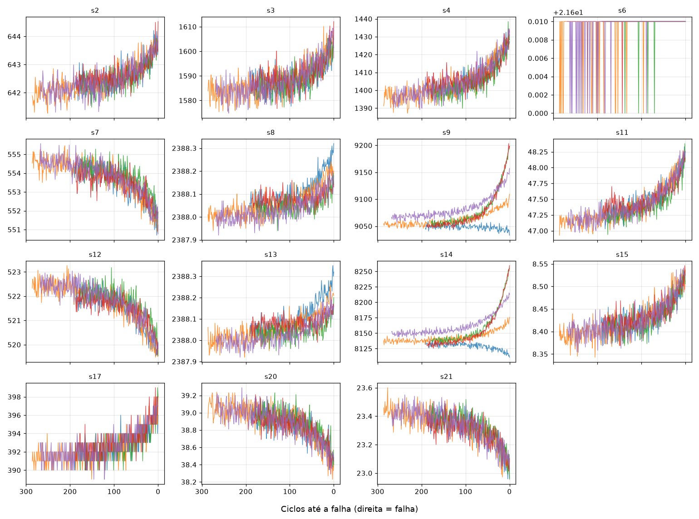
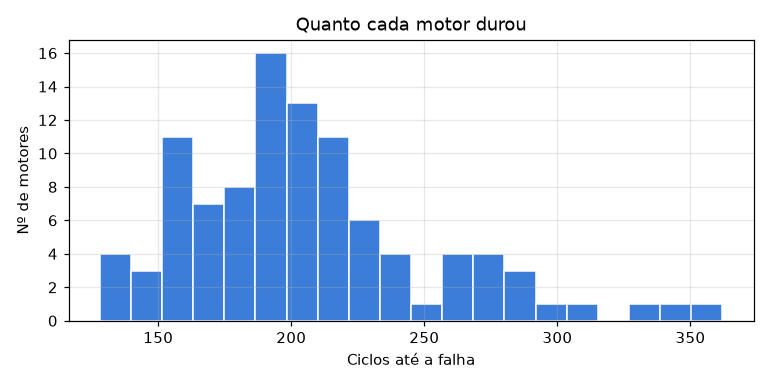
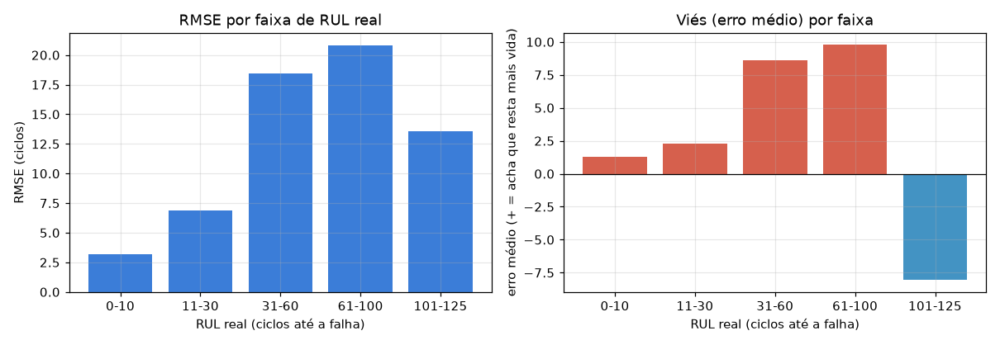
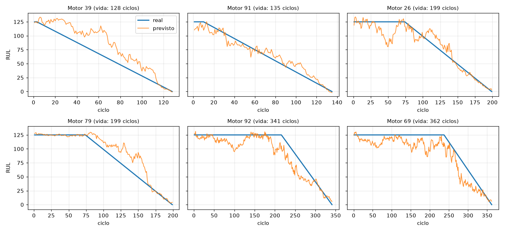

# Predição de vida útil de motores (NASA C-MAPSS)

> Preencha este README conforme avança. Substitua os trechos entre `[colchetes]`.

## Problema
Prever quantos ciclos de operação ainda restam (RUL, *Remaining Useful Life*) para cada motor turbofan a partir de leituras de sensores, para apoiar **manutenção preditiva**. Inspirado no meu projeto de monitoramento e manutenção preditiva do Grand Prix SENAI (2º lugar na América Latina).

## Dados
NASA C-MAPSS, subconjunto FD001: [100] motores de treino, [100] de teste, 21 sensores e 3 condições operacionais.

Dos 21 sensores, 6 são constantes (s1, s5, s10, s16, s18, s19) e foram descartados.
Os sensores s2, s3, s4, s8, s11, s13, s15 e s17 sobem perto da falha, e s7, s12, s20 e s21 descem.



Com esses dados podemos ver como fica a distribuição da vida útil dos motores.



## Método
1. Exploração e remoção de sensores constantes (Feito)
2. Baseline: Regressão Linear e Random Forest   (Feito)
3. [Engenharia de variáveis: médias móveis, etc.] (em andamento)
4. [XGBoost e rede em PyTorch]
5. Validação separando por motor (sem vazamento entre treino e validação)

## Resultados

RMSE em ciclos de vida útil restante (quanto menor, melhor). A escolha do modelo e dos hiperparâmetros
usou **validação cruzada em 5 partes agrupada por motor** (nenhum motor aparece em treino e validação ao
mesmo tempo). O conjunto de teste (último ciclo de cada um dos 100 motores do FD001) foi usado só no final.
Os modelos finais foram repetidos com 5 sementes (média ± desvio).

| Modelo | Variáveis | RMSE CV | RMSE teste |
|---|---|---|---|
| Regressão Linear (baseline) | sensores brutos | n/d | 20,82 |
| Random Forest (baseline) | sensores brutos | n/d | 17,16 |
| Random Forest (ajustado) | sensores + estatísticas móveis | 16,67 ± 0,02 | 16,58 ± 0,16 |
| **XGBoost (ajustado)** | sensores + estatísticas móveis | **15,25 ± 0,03** | **15,96 ± 0,19** |

**O que funcionou:** estatísticas móveis (média e desvio em janelas de 5, 15 e 30 ciclos) por motor reduziram
o erro nos dois modelos. O XGBoost com `max_depth=4`, `learning_rate=0.03` e 800 árvores foi o melhor.

**O que não funcionou:** o ajuste de hiperparâmetros trouxe ganho pequeno (CV de 15,49 para 15,31 no XGBoost,
dentro do ruído entre as partes da validação). O Random Forest padrão do sklearn ficou entre os piores
(CV 17,07), e mais regularização não melhorou o CV.

**Limitações:** apenas o subconjunto FD001 (uma condição operacional); teste com 100 motores, então diferenças
pequenas (~0,3) podem ser ruído; a análise de onde o modelo erra mais ainda está em andamento.


### Sensibilidade ao limite (cap) da RUL

O alvo de treino foi limitado a 125 ciclos (padrão do C-MAPSS), pois enquanto o motor está saudável os sensores
não carregam informação sobre quanto ainda resta. Como isso é uma escolha de modelagem, testei outros valores
com o mesmo XGBoost (3 sementes, validação por motor), medindo sempre contra a RUL real **sem limite**.

| Cap | CV (RUL ≤ 75) | CV (RUL ≤ 125) | Teste (real ≤ 125) | Teste (sem limite) |
|---|---|---|---|---|
| 75 | 8,48 | 20,94 | 27,47 | 29,61 |
| 100 | 12,79 | 15,08 | 16,53 | 18,72 |
| **125** | 16,03 | 16,55 | **15,98** | **17,25** |
| 150 | 17,88 | 20,14 | 20,96 | 21,42 |
| sem cap | 20,76 | 28,26 | 32,04 | 31,75 |

- Treinar sem limitar o alvo piora muito o modelo, mesmo medindo contra a RUL real sem limite (31,75 vs 17,25).
- Com cap 125, o RMSE no teste é 15,98 se a RUL real também for limitada a 125 (padrão da literatura) e **17,25 contra a RUL real
  sem limite**: 11 dos 100 motores de teste têm RUL real acima de 125, que o modelo não prevê.
- Caps menores (75, 100) melhoram o erro perto da falha em parte por limitarem o que o modelo pode prever, e o cap 75 piora no
  teste por ficar cego acima de 75. Entre 100 e 125 não há vencedor claro; mantive 125 por ser o padrão.

### Análise de erros

O modelo final (XGBoost com estatísticas móveis) foi analisado com previsões fora da amostra da validação
cruzada (por motor) e, só para descrever, no conjunto de teste. O notebook completo está em
`notebooks/02_analise_erros.ipynb`.

| RUL real (ciclos até a falha) | RMSE | Viés (previsto − real) | Linhas |
|---|---|---|---|
| 0-10 | 3,21 | +1,31 | 1.100 |
| 11-30 | 6,88 | +2,26 | 2.000 |
| 31-60 | 18,43 | +8,61 | 3.000 |
| 61-100 | 20,84 | +9,80 | 4.000 |
| 101-125 | 13,54 | −8,07 | 10.531 |



- **Onde erra mais:** na zona de transição (RUL real de 31 a 100), com RMSE de 18,43 a 20,84 ciclos, contra 3,21 a
  6,88 perto da falha (RUL ≤ 30).
- **Viés:** otimista (superestima a vida restante) até RUL 100, o que é o erro mais custoso em manutenção. O viés
  negativo na faixa 101-125 é em boa parte estrutural, pois a verdade fica no teto do cap de 125.
- **Regressão à média:** o viés por motor correlaciona-se com a vida do motor (r = −0,65, n = 100, só linhas com
  RUL ≤ 100): motores de vida curta são superestimados e os de vida longa subestimados. O modelo não distingue, a
  cada instante, um motor de degradação rápida de um de degradação lenta.
- **Teste:** RMSE 15,96 ± 0,19 (RUL real limitada a 125, média de 5 sementes) e 17,25 contra a RUL real sem limite;
  59% dos motores com erro positivo (n = 100).


## Como rodar

```bash
python -m venv .venv && source .venv/bin/activate   # Windows: .venv\Scripts\Activate.ps1
pip install -r requirements.txt
# coloque train_FD001.txt, test_FD001.txt e RUL_FD001.txt em data/
python -m pytest
PYTHONPATH=src python -m cmapss.train_baseline --data-dir data
```

## Estrutura
```
src/cmapss/     código (carregamento de dados, treino)
notebooks/      exploração e experimentos
tests/          testes
results/        métricas geradas
```

## Próximos passos
- [ ] [Adição de medias móveis]
- [ ] [modelar com XGBoost]
- [ ] [Validação por motor]
