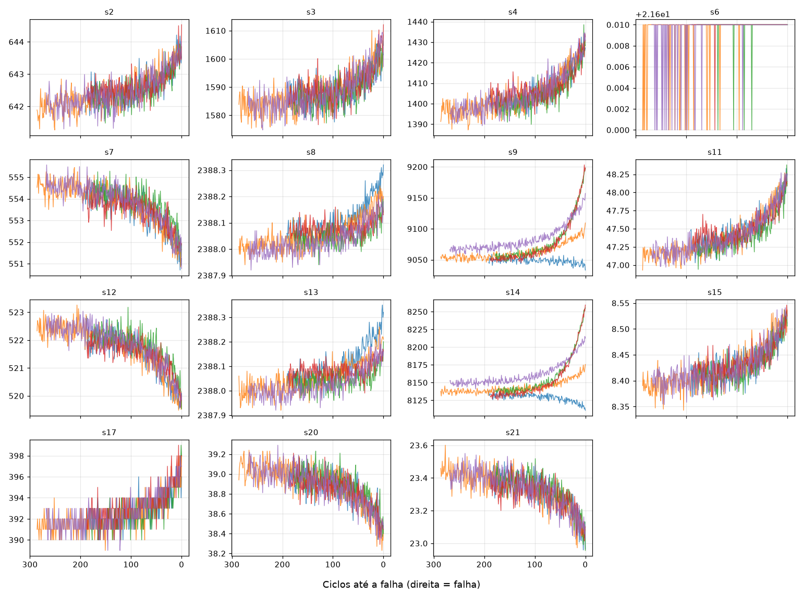
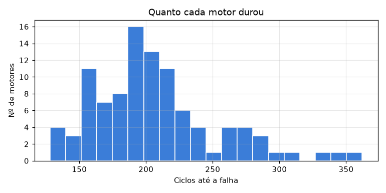

# Predição de vida útil de motores (NASA C-MAPSS)

> Preencha este README conforme avança. Substitua os trechos entre `[colchetes]`.

## Problema
Prever quantos ciclos de operação ainda restam (RUL, *Remaining Useful Life*) para cada motor turbofan a partir de leituras de sensores, para apoiar **manutenção preditiva**. Inspirado no meu projeto de monitoramento e manutenção preditiva do Grand Prix SENAI (2º lugar na América Latina).

## Dados
NASA C-MAPSS, subconjunto FD001: [100] motores de treino, [100] de teste, 21 sensores e 3 condições operacionais.

Dos 21 sensores, 6 são constantes (s1, s5, s10, s16, s18, s19) e foram descartados.
Os sensores s2, s3, s4, s8, s11, s13, s15 e s17 sobem perto da falha, e s7, s12, s20 e s21 descem.



Com esses dados podemos ver como fica a distribuição da vida útil dos motores.



## Método
1. Exploração e remoção de sensores constantes (Feito)
2. Baseline: Regressão Linear e Random Forest   (Feito)
3. [Engenharia de variáveis: médias móveis, etc.] (em andamento)
4. [XGBoost e rede em PyTorch]
5. Validação separando por motor (sem vazamento entre treino e validação)

## Resultados

RMSE em ciclos de vida útil restante (quanto menor, melhor). A escolha do modelo e dos hiperparâmetros
usou **validação cruzada em 5 partes agrupada por motor** (nenhum motor aparece em treino e validação ao
mesmo tempo). O conjunto de teste (último ciclo de cada um dos 100 motores do FD001) foi usado só no final.
Os modelos finais foram repetidos com 5 sementes (média ± desvio).

| Modelo | Variáveis | RMSE CV | RMSE teste |
|---|---|---|---|
| Regressão Linear (baseline) | sensores brutos | n/d | 20,82 |
| Random Forest (baseline) | sensores brutos | n/d | 17,16 |
| Random Forest (ajustado) | sensores + estatísticas móveis | 16,67 ± 0,02 | 16,58 ± 0,16 |
| **XGBoost (ajustado)** | sensores + estatísticas móveis | **15,25 ± 0,03** | **15,96 ± 0,19** |

**O que funcionou:** estatísticas móveis (média e desvio em janelas de 5, 15 e 30 ciclos) por motor reduziram
o erro nos dois modelos. O XGBoost com `max_depth=4`, `learning_rate=0.03` e 800 árvores foi o melhor.

**O que não funcionou:** o ajuste de hiperparâmetros trouxe ganho pequeno (CV de 15,49 para 15,31 no XGBoost,
dentro do ruído entre as partes da validação). O Random Forest padrão do sklearn ficou entre os piores
(CV 17,07), e mais regularização não melhorou o CV.

**Limitações:** apenas o subconjunto FD001 (uma condição operacional); teste com 100 motores, então diferenças
pequenas (~0,3) podem ser ruído; a análise de onde o modelo erra mais ainda está em andamento.

## Como rodar

```bash
python -m venv .venv && source .venv/bin/activate   # Windows: .venv\Scripts\Activate.ps1
pip install -r requirements.txt
# coloque train_FD001.txt, test_FD001.txt e RUL_FD001.txt em data/
python -m pytest
PYTHONPATH=src python -m cmapss.train_baseline --data-dir data
```

## Estrutura
```
src/cmapss/     código (carregamento de dados, treino)
notebooks/      exploração e experimentos
tests/          testes
results/        métricas geradas
```

## Próximos passos
- [ ] [Adição de medias móveis]
- [ ] [modelar com XGBoost]
- [ ] [Validação por motor]
